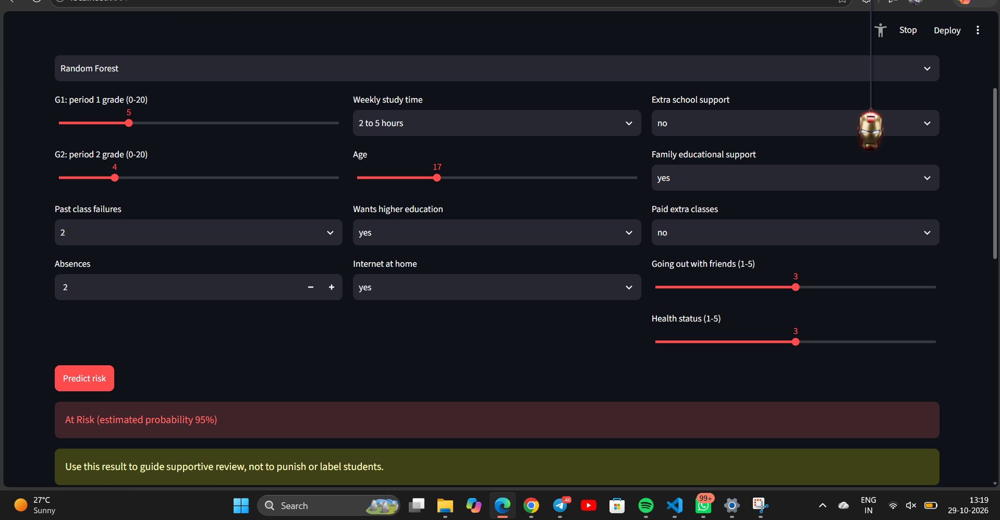
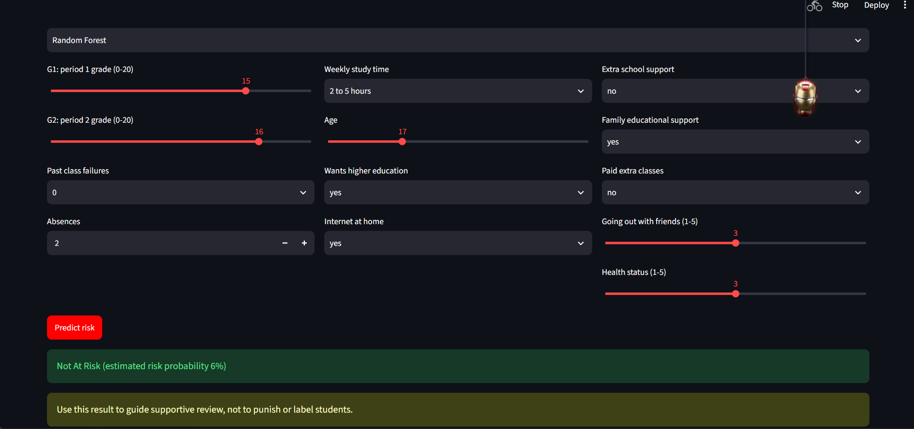
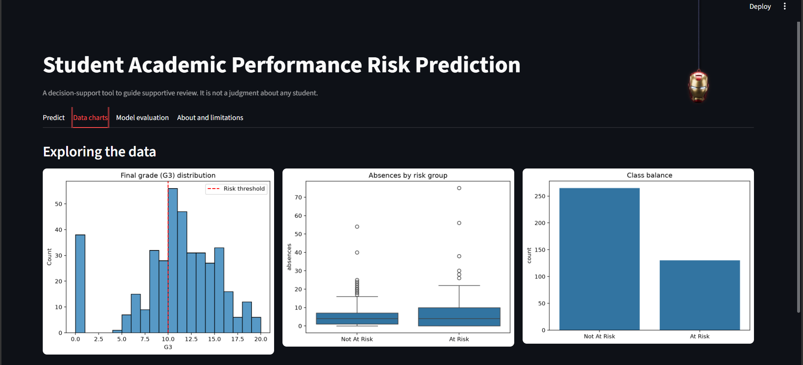
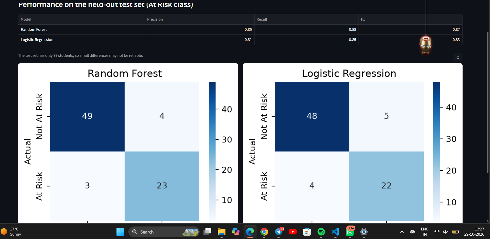
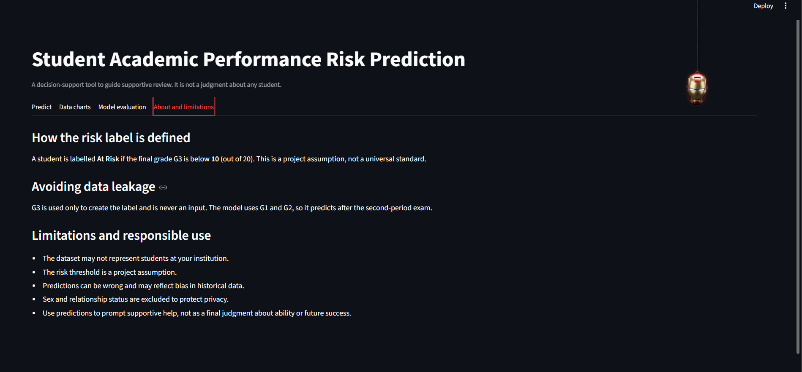

# Student Academic Performance Risk Prediction Using Machine Learning

A small end-to-end ML prototype that estimates whether a student may be at risk of low academic performance. The output is a decision-support indicator to guide supportive review, not a judgment about any student.

Live demo: add your Streamlit Community Cloud link here after deploying

Features
Single-student prediction with an estimated risk probability.
Per-student explanation (SHAP) showing which factors raised or lowered the risk.
Supportive recommendations based on the main risk factors.
Batch mode: upload a class CSV, get a ranked risk table, and download the results.
Fairness check comparing recall and precision across student groups.
5-fold cross-validation with mean ± standard deviation.
Data charts and model evaluation (precision, recall, F1, confusion matrices).
Limitations tab explaining the label definition and responsible use.
Dataset

UCI Student Performance dataset (student-mat.csv, 395 students). src/clean_data.py produces the cleaned file data/student-mat-cleaned.csv that the project uses.

Cortez, P., & Silva, A. (2008). Using Data Mining to Predict Secondary School Student Performance. Proceedings of the 5th Future Business Technology Conference, pp. 5-12.

# Risk label

A student is At Risk if the final grade G3 is below 10 (out of 20). This is a project-defined threshold, not a universal standard.

# Avoiding data leakage

G3 is used only to create the label and is never an input. The model uses G1 and G2, so it predicts after the second-period exam. sex and romantic are excluded to protect privacy.

Note that G2 is very close to the final grade, so it carries much of the predictive power. This tool is therefore best seen as a mid-year check, not an early prediction.

# Models
Logistic Regression (baseline)
Random Forest (comparison)

Both use a scikit-learn Pipeline with a stratified 80/20 split, random_state=42 and balanced class weights.

Results (At Risk class, test set of 79 students)
Model	Precision	Recall	F1
Logistic Regression	0.81	0.85	0.83
Random Forest	0.85	0.88	0.87

The test set is small, so differences between models may not be reliable. After retraining, update this table from results/test_metrics.csv. Mean ± std from 5-fold cross-validation is in results/cv_metrics.csv and in the app's Cross-validation tab.

# How to run
pip install -r requirements.txt
python src/clean_data.py
python src/train_model.py
python src/evaluate_model.py
python -m streamlit run app.py

train_model.py saves the models, the test split and models/metadata.json. evaluate_model.py saves charts to figures/ and metrics to results/.

Screenshots

Predict tab Batch tab Fairness tab Model evaluation tab

# Project structure
student-risk-prediction/
    data/           dataset CSVs
    src/            clean_data.py, data_preprocessing.py,
                    train_model.py, evaluate_model.py
    models/         saved models, test split, metadata.json
    figures/        saved charts
    results/        metrics CSV files
    screenshots/    dashboard screenshots
    app.py          Streamlit dashboard
    requirements.txt
    README.md
# Deployment

Deployed on Streamlit Community Cloud. The models/ and data/ folders must be committed to the repository, and requirements.txt should pin the same scikit-learn version used for training. The app warns if the versions differ.

Limitations and responsible use
The dataset may not represent students at your institution.
The risk threshold is a project assumption.
Predicted probabilities are estimates and may not be perfectly calibrated (see figures/calibration_curve.png).
SHAP explanations show associations in the model, not causes.
Fairness results on a small test set can be noisy, so treat them as warning signals, not proof of bias.
Predictions can be wrong and may reflect bias in historical data.
Use predictions to prompt supportive help, not as a final judgment about ability or future success.

## Screenshots

